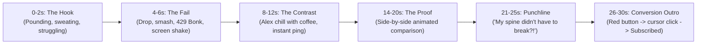

# 🎭 Character Director & 2D Comedy Skit Skill

Autonomous staging, kinematic posing, physical comedy direction, and puppet animation for the Faceless Video Production Engine. Replaces static text slides with engaging, character-driven storytelling inspired by viral animation channels (PixelStick Studio, Ricks Clips, Kurzgesagt).

---

## 1. When to Use
- **Short-form Tech Explainers (9:16 Shorts)**: Converting abstract developer or technical topics (e.g. SVG vs PNG, Polling vs Webhooks, Centering a Div) into comedic skits.
- **Relatable Conflict**: Pitting a struggling, naive protagonist (doing things the hard, heavy, bloated way) against a calm, knowledgeable expert (demonstrating the 100% free modern fix).
- **Physical Slapstick**: Heavy drops, mallet smashes, accordion squishes, camera screen shake, and cartoon foley.

---

## 2. The 30-Second Shorts Rhythm Formula

Every high-retention 30-second Short follows this 6-phase comedic rhythm:

| Phase | Runtime | Directing Goal | Character & Foley Action |
|---|---|---|---|
| **1. The Hook** | `0.0s – 3.5s` | Immediate physical struggle within 1.5s | Dave sweating, carrying 50MB or knocking frantically (`pose="carry"` or `"knocking"`) |
| **2. The Slapstick Fail** | `3.5s – 7.5s` | Comedic crash / physical payoff | Box drop or Mallet bonk, screen shake ($amp \cdot e^{-kt} \cdot \sin(\omega t)$), dust puffs, comic starburst |
| **3. The Contrast** | `7.5s – 12.0s` | Introduce the effortless alternative | Alex chilling in beach chair / smug smile, floating SVG or Webhook envelope, doorbell ding |
| **4. The Proof Demo** | `12.0s – 20.0s` | Visual "Aha!" comparison card | Side-by-side demonstration (e.g. Pixel grid vs Vector math, or Polling spam vs Webhook push) |
| **5. The Punchline** | `20.0s – 25.5s` | Comedic realization | Dave shocked/bandaged: *"Wait... it's that easy?!"*, Alex laughing bounce |
| **6. The Outro** | `25.5s – 29.8s` | High-converting subscribe sequence | Red pill button $\rightarrow$ Bezier cursor glide $\rightarrow$ click at spoken beat $\rightarrow$ green `✓ SUBSCRIBED!` + ripple ring |

---

## 3. Character Puppet Rigs (`tools/character_puppet.py`)

### 1. Dave (The Stressed Protagonist)
- **Signature Styling**: Backward red baseball cap, red sneakers with white soles and laces, blue jeans, kinetic sweat droplets.
- **Poses**:
  - `carry`: Knees bent, trembling vertical wobble under heavy weight (`math.sin(t * 14.0) * 4`).
  - `knocking`: Leaning forward, right fist pounding on cabinet with metallic knock foley.
  - `squished`: Accordion compressed flat on floor, splayed sneakers, spiral dizzy eyes (`dizzy`), circling stars.
  - `bandaged`: Arm in gauze sling, head bandage, bruised bewilderment.
  - `shocked`: Hands up to cheeks, wide open circular eyes, dropped jaw.

### 2. Alex (The Chill Expert)
- **Signature Styling**: Sharp green tie, green sneakers with white soles, cool smirk or sunglasses.
- **Poses**:
  - `beach_chair`: Lounging in folding lounge chair, sunglasses, sipping iced coffee with a straw.
  - `explaining`: Left hand on hip, right hand gestured upward pointing at floating demonstration card.
  - `laughing`: Hands on belly, chuckling vertical bounce (`math.sin(t * 16.0) * 4`).

---

## 4. Foley Sound Design Architecture

In character animation, **sound carries 50% of the comedy**. Every visual event must map to a foley cue:
- **Knocking**: Rapid metallic door knock transients (`make_metal_knock`).
- **Anticipation**: Slide whistles downward before impact (`make_slide_whistle`).
- **Impact**: Heavy bass rumble + woodblock transient for `BONK!` and `THUD!` (`make_mallet_bonk`).
- **Notifications**: Two-tone pleasant chime for arrivals (*Ding-dong!* `make_doorbell_ding`).
- **Music Bed**: Playful pizzicato walking bass groove (110–112 BPM) ducked cleanly by 70% under spoken dialogue.
- **Mastering**: Strict broadcast standard ITU-R BS.1770 mastered to **-15.0 LUFS** (true peak $\le -1.5\text{ dBFS}$).

---

## 5. Subtitle & Layout Clearance Invariants

- **Safe Subtitle Placement**: On 1080×1920 (9:16 Shorts), subtitles are centered at $y = 1730\text{px}$.
- **Character Ground Line**: Character feet sit at $y = 1580\text{px}$.
- **Clearance Buffer**: An 80px minimum buffer separates the lowest character geometry from the subtitle container, ensuring zero text collisions.
- **Karaoke Pacing**: 3 words per chunk max. Active word illuminates in Electric Yellow `(255, 205, 50)` with bold black stroke. Speaker pills (`[DAVE]` in Orange, `[ALEX]` in Cyan) identify the active speaker.
